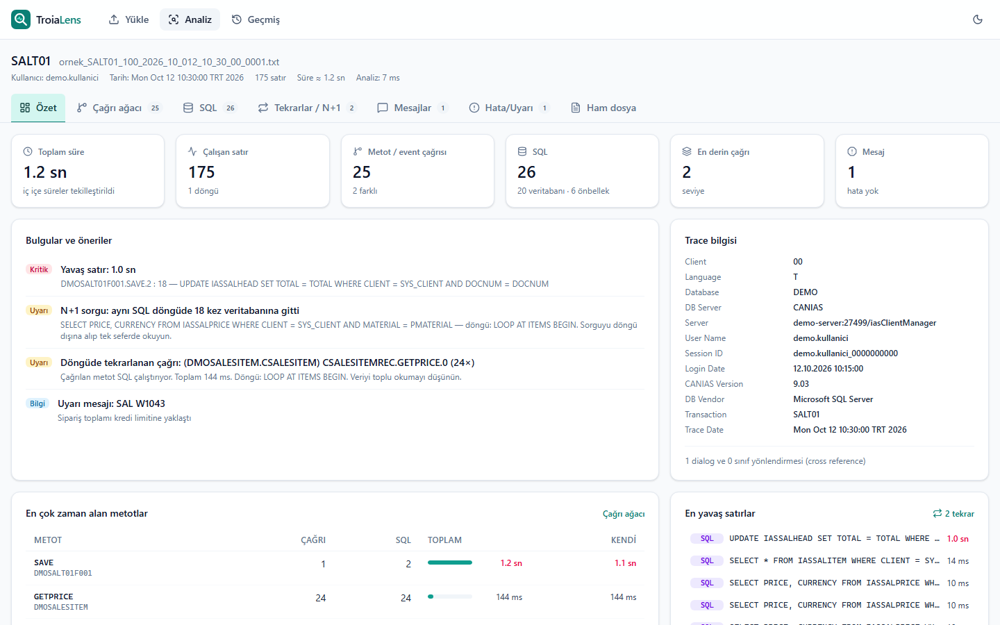
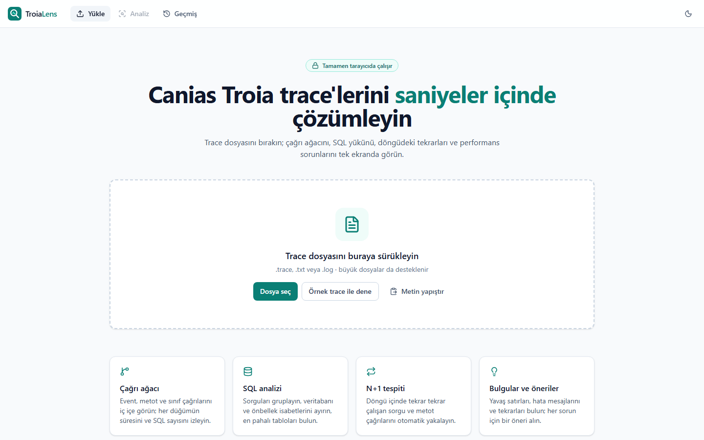
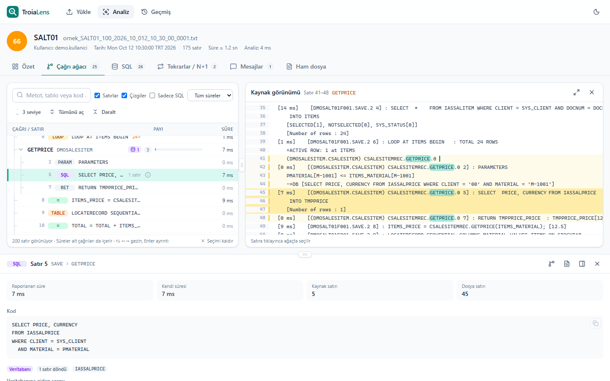
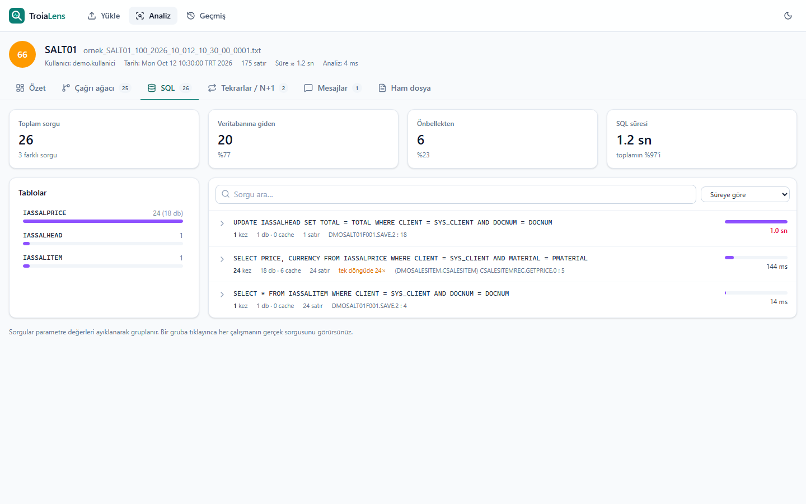
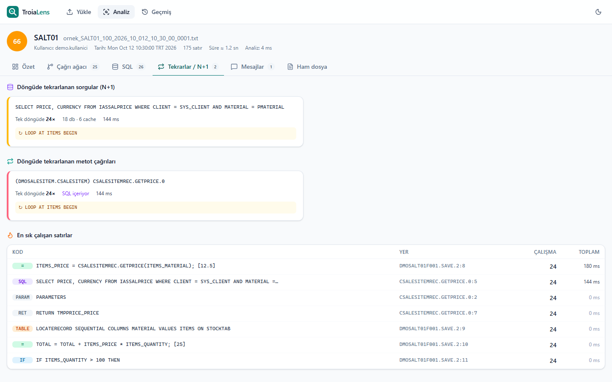
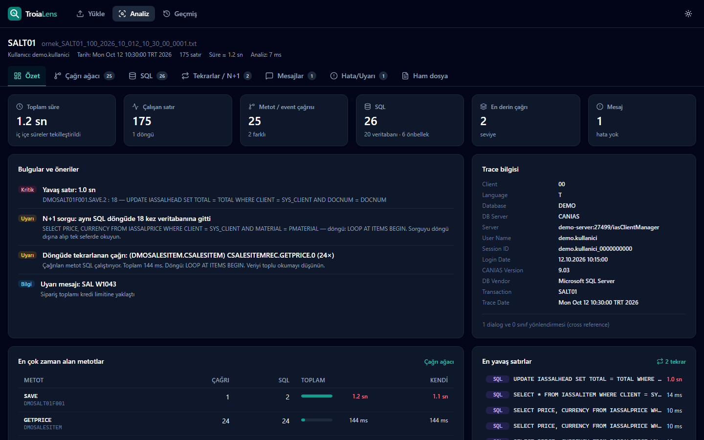

# TroiaLens


Canias ERP'nin ürettiği **TROIA CODE EXECUTION TRACE** dosyalarını analiz eden web uygulaması.

- Çağrı ağacı: event, metot ve sınıf çağrıları, her düğümün süresi ve SQL sayısı. Açılacak seviye ↑↓ ile seçilir.
- Kaynak görünümü: ağaçta seçilen satır, metot bloğu işaretli olarak trace dosyasında. Kenarından sürüklenerek
  genişletilir, tek tıkla ekranı kaplar.
- Satır ayrıntısı alt bölmede ya da sağda kayan panelde (başlıktaki düğmeyle geçilir); kod bloklarında kopyala düğmesi.
- SQL analizi: sorgular parametresiz haliyle gruplanır, veritabanı ve önbellek isabetleri ayrılır.
- N+1 tespiti: aynı döngü çalışmasında tekrar eden sorgu ve metot çağrıları.
- Sağlık skoru: 0–100 arası skor ve öneri listesi.
- Ham dosya görünümü, geçmiş (tarayıcıda saklanır), açık / koyu tema.

Her şey tarayıcıda çalışır. Sunucu yoktur, trace dosyası hiçbir yere gönderilmez.

## Ekran görüntüleri

Görüntüler `public/sample-trace.txt` örnek dosyasıyla alındı (uydurma veri).



| | |
|---|---|
|  |  |
| Ana sayfa | Çağrı ağacı, kaynak görünümü ve alttaki satır ayrıntısı |
|  |  |
| SQL analizi | Tekrarlar ve N+1 |
|  | |
| Koyu tema | |

## Kullanım

```bash
npm install
npm run dev        # geliştirme sunucusu
npm run build      # statik çıktı -> dist/
npm run preview    # dist/ klasörünü yerelde sunar
npm test           # parser regresyon testi
```

`dist/` herhangi bir statik sunucuda (GitHub Pages, IIS, nginx...) alt klasör dahil her yoldan yayınlanabilir (`base: './'`).
`index.html` dosyasını çift tıklayıp `file://` ile açmak çalışmaz: analiz bir modül Web Worker'da yapılır ve tarayıcılar
modül worker'ı `file://` üzerinden yüklemez.

| | |
|---|---|
| Teknoloji | Vite 8, React 19, TypeScript 7, Tailwind CSS 4, lucide-react |
| Gereksinim | Node.js 22.12+ |

## Dosya yapısı

```
src/lib/types.ts         Veri modeli (Statement, Scope, Analysis, LoadedTrace...)
src/lib/parser.ts        Trace metnini ağaca çevirir  ← çekirdek
src/lib/analyze.ts       İstatistik, N+1, bulgular, sağlık skoru
src/lib/worker.ts        Parser + analizi Web Worker'da çalıştırır
src/lib/run.ts           Worker çağrısı, dosya okuma (UTF-8 / windows-1254), dosya adı çözümleme
src/lib/storage.ts       Geçmiş (IndexedDB)
src/lib/host.ts          Gömülü mod köprüsü (WebView2), inHost()
src/lib/locate.ts        Ağaç satırı ↔ dosya satırı eşlemesi, editör işaretleri, tek başına CR düzeltmesi
src/App.tsx              inHost() ? EmbeddedApp : StandaloneApp
src/apps/StandaloneApp   Tarayıcı uygulaması: hash router #/  #/analiz  #/gecmis
src/apps/EmbeddedApp     Gömülü mod: içerik host uygulamadan gelir
src/pages/               Home, AnalysisPage, History
src/components/analysis  Overview, CallTree, SourcePane, SqlView, RepeatsView, MessagesView, RawView, StatementDetail
src/components/ui.tsx    Ortak parçalar: VirtualList (sabit satır yüksekliği), CodeBlock, ResizeHandle
scripts/parse-check.ts   Komut satırından parser testi
scripts/make-sample.ts   public/sample-trace.txt üretir (uydurma veri)
samples/                 Gerçek trace'ler — repoda yok, bkz. "Test"
```

## Gömülü mod

Sayfa bir WebView2 içinde açılırsa (`window.chrome.webview` varsa) gömülü modda çalışır: üst menü, yükleme ve geçmiş
yoktur; trace'i host uygulama (ör. bir editör eklentisi) gönderir. Bir satıra tıklanınca host'a satır numarası bildirilir.
Analiz ekranı ve tüm görünümler iki modda aynıdır; aradaki fark `AnalysisPage`'in `embedded` bayrağındadır.

| Yön | Mesaj |
|---|---|
| sayfa → host | `{ type: 'ready' }`, `{ type: 'gotoLine', line, focus }`, `{ type: 'mark', from, to, line, lineEnd, word }`, `{ type: 'clearMarks' }`, `{ type: 'reload' }`, `{ type: 'setPrefs', detailSlideOver }` |
| host → sayfa | `{ type: 'theme', dark }`, `{ type: 'prefs', detailSlideOver }`, `{ type: 'load', name, text }`, `{ type: 'loadUrl', name, url }`, `{ type: 'notTrace', name }`, `{ type: 'empty' }`, `{ type: 'caret', line }` |

- Host metni ancak `ready` mesajından sonra gönderir. Büyük dosyalarda `loadUrl` tercih edilir; sayfa metni `fetch(url)` ile okur.
- `line` 1 tabanlıdır ve parser'ın saydığı dosya satırıdır (`\r?\n` ile bölünmüş).
- Sayfa `?theme=dark|light` parametresini ilk boyamada kullanır.

---

## Trace formatı

Format Canias tarafından belgelenmemiştir. Aşağıdaki kurallar gerçek trace'lerden çıkarıldı (CANIAS 9.03).

### Genel

- Kodlama UTF-8. Eski kurulumlarda windows-1254 olabilir (UTF-8 başarısız olursa ona düşülür).
- Satır sonu CRLF veya LF. **Satır içinde tek başına CR olabilir** (çok satırlı SQL kaynağı). Satırlar yalnızca
  `\r?\n` ile bölünür, kalan `\r` karakterleri boşlukla değiştirilir.
- İki özel karakter yapıyı belirler:
  - `▎` (U+258E): satır sonunda, bir scope (metot/event) **açar**.
  - `▏` (U+258F): bir scope veya blok **kapatır**. Bir satırda birden çok olabilir (`▏ ▏`).

### Başlık (opsiyonel)

Bazı dosyalarda başlık hiç yoktur; dosya doğrudan bir scope ile başlar.

```
TROIA CODE EXECUTION TRACE

TRACE INFORMATION▎
-----------------------------------------------
LOGIN INFORMATION
User Name            : [kullanici.adi]
...
DIALOG CROSS REFERENCES
[Old Dialog] -> [New Dialog]
SALT01F001 -> DMOSALT01F001, (SYSDLGREF)
CLASS CROSS REFERENCES
SALESITEM -> DMOSALESITEM, (SYSCLSREF)
-----------------------------------------------▏      ← başlık burada biter
```

- Bölüm adı: tamamı büyük harf, `:` içermeyen satır.
- Alan: `Anahtar : [Değer]`.
- Yönlendirme: `ESKI -> YENI, (TÜR)`.
- Gövde, `^-{10,}\s*▏` satırından sonra başlar. Böyle bir satır yoksa ilk statement veya scope satırından başlar.

### Gövde satır tipleri

| Tip | Örnek | Regex (`parser.ts`) |
|---|---|---|
| Scope açılışı | ` \t(DMOSALESITEM.CSALESITEM) CSALESITEMREC.GETPRICE.0 ▎` | `^\s*(\S.*?)\s*▎\s*$` |
| Statement | ` [0 ms]    [DMOSALT01F001.SAVE.2 3] : IF X == 1 THEN : X[1] == 1 -> 1` | `^\s*\[(\d+(?:[.,]\d+)?)\s*(ms\|sec\|s\|min\|us\|µs)\]\s*\[(.+?)\s+(\d+)\]\s*:\s?(.*)$` |
| Detay | `\t+ACTIVE ROW: 2 at ITEMS` | Satır tab ile başlar |
| Devam | Önceki değerin ikinci satırı (tab yok) | Diğerleri eşleşmezse |

**Statement satırı:** `[süre] [SCOPE_ADI KAYNAK_SATIRI] : KOD : DEĞERLENDİRME`

- Süre birimi `ms` veya `sec` (`[1 sec]`). `sec` tam saniyeye yuvarlanmış olabilir.
- Scope adındaki son sayı, metodun içindeki kaynak satır numarasıdır.
- İlk `" : "` kodu, değerlendirme izinden (trail) ayırır. Örneğin `RETURN MODI  : MODI[1]`.
  `X = 1; [1]` gibi satırlarda ayırıcı yoktur.

**Scope adı iki biçimde gelir:**

- `(SINIF.TABAN_SINIF) NESNE.METOT.N`: sınıf metodu, ör. `(DMOSALESITEM.CSALESITEM) CSALESITEMREC.GETPRICE.0`
- `DIALOG.EVENT.N`: dialog event'i, ör. `DMOSALT01F001.SAVE.2`

**Detay satırları (tab ile başlar):**

| Satır | Anlamı |
|---|---|
| `+TRUE BLOCK STARTED` / `+ELSE BLOCK STARTED` | IF bloğu başladı |
| `-TRUE BLOCK ENDED` / `-ELSE BLOCK ENDED` | IF bitti. **Her IF için tam bir tane gelir.** Koşul yanlış ve ELSE yoksa IF'ten hemen sonra gelir. |
| `ENDLOOP`, `-ENDWHILE`, `-ENDSWITCH` | Döngü / switch bitti |
| `+ACTIVE ROW: N at TABLO` | LOOP AT iterasyonu |
| `+START ITERATION{n}` / `-END ITERATION{n}` | WHILE iterasyonu |
| `+CASE : 1` | SWITCH dalı |
| `> CONDITION: ...` | WHILE koşulunun değerlendirmesi |
| `->DB [SQL]` | **Bir sonraki** SQL statement'ının veritabanına giden, parametreleri çözülmüş hali |
| `->DB CACHE [SQL]` | Aynısı, ama sonuç Canias önbelleğinden geldi (veritabanına gidilmedi) |
| ` INTO TABLO` | SELECT'in hedef bellek tablosu |
| `[SELECTED[1], NOTSELECTED[0], SYS_STATUS[0]]` | SQL sonucu bayrakları |
| `[Number of rows : N]` | SQL'in döndürdüğü satır sayısı |
| `PMATERIAL[x] <= ITEMS_MATERIAL[x]` | PARAMETERS statement'ının parametre ataması |
| `CHANGED COLUMNS: ...` | COPY / MOVE sonrası değişen kolonlar |

### Kapanış işaretinin tuzağı

`▏` her zaman "scope kapandı" demek değildir. RETURN bir IF bloğunun içindeyse önce scope kapanır,
ardından açık kalan blokların bitiş satırları kendi `▏` işaretleriyle gelir:

```
 [0 ms]    [...CHECKDIFF.0 61] : RETURN RESULT  : RESULT[0] ▏   ← scope kapandı
	-TRUE BLOCK ENDED ▏                                      ← blok, scope DEĞİL
	-ELSE BLOCK ENDED ▏ -> RESULT[0], ...                     ← blok + sonraki satırın trail'i
```

Çözüm (`parser.ts`):

- Her scope kendi açık blok yığınını tutar. IF, LOOP, WHILE ve SWITCH statement'ı bir blok iter.
- Scope `▏` ile kapanınca, açık kalan blok sayısı bir **borç** sayacına eklenir.
- Blok bitiş satırı `▏` içeriyorsa ve borç sıfırdan büyükse, o `▏` borçtan düşülür; scope kapatılmaz.
- Güvenlik ağı: her statement kendi scope adını taşır. Yığının tepesi bu adla eşleşmiyorsa yığın o
  ada kadar geri sarılır. Ad yığında hiç yoksa "implicit" scope açılır (trace bir çağrının ortasında başlamışsa).

### Çağrıların sırası

- **İfade içindeki çağrılar** (`IF X.GETMODI() == 1`, `OBJECT: CLASS[...]` yapıcıları, atamalar) önce
  çağrılan scope'u basar, sonra çağıran statement satırını.
- **Doğrudan çağrı** statement'ında (`DMOSALESITEM.GETPRICE()`) önce statement, sonra scope gelir.

## Süre modeli

Raporlanan süre **kapsayıcıdır**: bir `OBJECT` satırının süresi, içinde çalışan `__VARIABLES` ve onun içindeki
`OBJECT` satırlarını da kapsar. Düz toplanırsa aynı süre birkaç kez sayılır.

`measureScopes()` her statement'ı, kapsadığı işle birlikte bir **birim** sayar:

- Statement'tan hemen önce gelen scope'lar (ifade çağrıları).
- `call` tipindeyse hemen sonra gelen scope.
- IF / LOOP / WHILE / SWITCH ise bloğunun içeriği (`blockEnd` indeksine kadar).

Hesap:

- `birim süresi = max(raporlanan, kapsanan işin süresi)`
- `kendi süresi (exclMs) = max(0, raporlanan - kapsanan)`
- `scope.totalMs = birimlerin toplamı`
- `scope.selfMs = kendi statement'larının exclMs toplamı`

Bu bir tahmindir; arayüzde toplam süre "≈" ile gösterilir. "Yavaş satır" bulgusu **exclMs** kullanır,
böylece aynı yavaşlık iç içe birkaç satırda tekrar işaretlenmez. `TRACEPAUSE WAIT` satırları kullanıcı beklemesi
olabilir; şu an ayrıca ele alınmıyor.

## Analiz kuralları (`analyze.ts`)

| Çıktı | Tanım |
|---|---|
| Metot istatistiği | Scope adına göre çağrı sayısı, toplam ve kendi süre, SQL sayısı. Özyinelemede yalnızca en dıştaki toplam sayılır. |
| Sık satırlar | `scopeAdı#kaynakSatırı` anahtarına göre çalışma sayısı |
| SQL grupları | Normalize edilmiş SQL'e göre gruplanır: `[...]` değerleri, string ve sayı literalleri `?` olur. db / cache sayısı, satır sayısı, tablolar. |
| N+1 / tekrar | Önce **tek bir döngü çalışması** (LOOP statement id'si) içinde sayılır, sonra aynı döngü satırının çalışmaları birleştirilir. `maxPerRun >= 5` olanlar raporlanır. Döngü bilgisi çağrılan metotlara miras kalır (`callerLoop`). |
| Mesajlar | `MESSAGE MODÜL TİP NUMARA WITH ...` (E=hata, W=uyarı, I=bilgi, S=başarılı). Metin trail'deki `MSG[...]` kısmından alınır. |

**Sağlık skoru:** 100'den başlar, bulgu başına puan düşer. Her kategorinin bir tavanı vardır.

| Bulgu | Ceza | Tavan |
|---|---|---|
| N+1 (döngüde ≥5 gerçek DB sorgusu) | 15 | 40 |
| N+1 ama çoğu önbellekten | 2 | (aynı tavan) |
| Döngüde tekrarlanan çağrı, SQL içeriyor / içermiyor | 8 / 2 | 16 |
| Yavaş satır, exclMs ≥ 1000 / ≥ 200 ms | 10 / 3 | 25 |
| 100'den / 500'den fazla DB sorgusu | 5 / 10 | 10 |
| Hata / uyarı mesajı | 5 / 1 | 15 |
| ≥1000 kez çalışan satır, döngüde ≥50 `LOCATERECORD SEQUENTIAL` | 5 / 3 | 10 |
| Çağrı derinliği ≥ 20 | 3 | 3 |

Not aralıkları: ≥90 Mükemmel, ≥75 İyi, ≥50 Orta, altı Zayıf. Eşikler `THRESHOLDS` sabitinde.

## Bilinen sınırlar

- `INSERT`, `UPDATE` ve `DELETE` gerçek bir trace'te henüz görülmedi. Regex bu komutları tanıyor ama doğrulanmadı.
- `->DB` satırı her zaman bir sonraki SQL statement'ına bağlanır. Araya başka bir SQL girerse eşleşme kayar.
- Süre modeli tahmine dayalıdır. `[N sec]` yuvarlaması küçük süreleri bozabilir.
- Detay satırları statement başına ilk 40 ile sınırlıdır (bellek tasarrufu).
- Yalnızca CANIAS 9.03 trace'leri ile test edildi.

## Test

`npm test` (`scripts/parse-check.ts`) her dosya için ağaç, bulgular, SQL grupları ve tekrarları basar, ardından
beklenen değerleri karşılaştırır. Tutmazsa hata koduyla çıkar.

- `public/sample-trace.txt` uydurma veridir (beklenen skor 66). Repoda olan tek test dosyası budur.
- Gerçek trace'ler kullanıcı adı, sunucu adresi ve parola hash'i içerir; **repoya eklenmez**. `samples/` klasörüne
  koyun (git dışı). Beklenen değerleri `samples/expected.json` dosyasına yazın:

```json
[
  { "match": "ISLEMKODU", "score": 89, "sql": 0 },
  { "match": "BASKAISLEM", "score": 62, "sql": 570, "sqlDb": 311, "sqlCache": 259, "scopes": 1118 }
]
```

`match`, dosya yolunda aranan bir düzenli ifadedir. Parser veya analizde değişiklik yaptıktan sonra `npm test`
çalıştırın ve sayıların değişmediğini kontrol edin; değişiklik bilinçliyse beklenen değerleri güncelleyin.

Başka bir dosyayı denemek için: `node --experimental-strip-types scripts/parse-check.ts <dosya>`.
